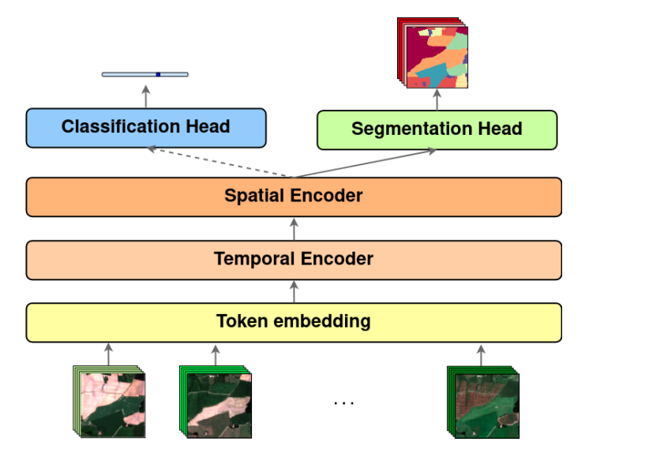
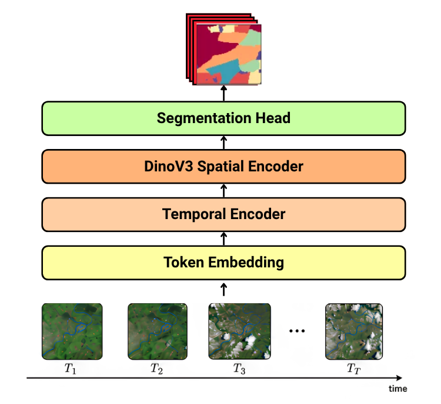
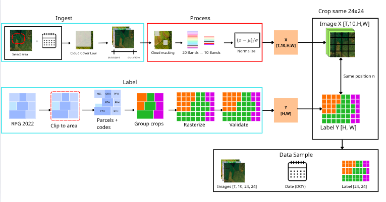
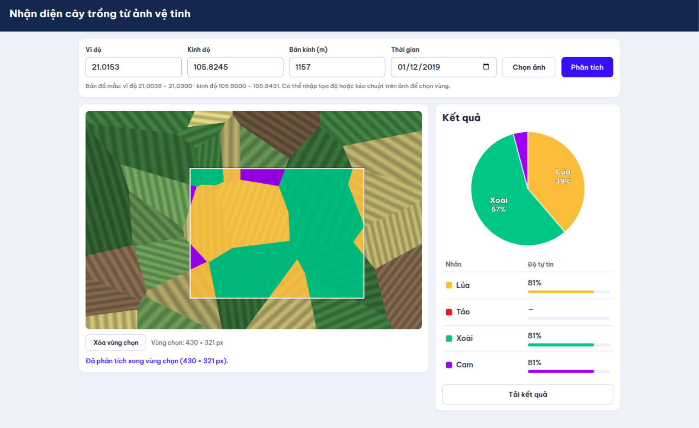

# TSViT + DINOv3: Multi-Temporal Satellite Crop Classification

Integration of **Meta DINOv3**-style vision transformer architecture into **TSViT** (Vision Transformers for Satellite Image Time Series) for pixel-wise agricultural land-cover and crop-type classification on Sentinel-2 satellite time-series.

> **Project Status:** Model integration, unit tests, and demo inference pipeline have been implemented. The current interactive dashboard uses author's baseline TSViT checkpoint; it does not demonstrate a trained DINOv3 model. Full DINOv3 training and held-out spatial evaluation remain in progress. Quantitative benchmark metrics will be published only after the spatial evaluation protocol and test results are finalized.

## Table of Contents

- [1. Project Overview](#1-project-overview)
- [2. System Overview](#2-system-overview)
- [3. Environment](#3-environment)
- [4. Setup](#4-setup)
- [5. Run & Verify](#5-run--verify)
- [6. Usage / API](#6-usage--api)
- [7. AI Model & Loss Formulation](#7-ai-model--loss-formulation)
- [8. Troubleshooting](#8-troubleshooting)

---

## 1. Project Overview

| Attribute | Technical Specification |
| :--- | :--- |
| **Task** | Pixel-wise multi-temporal semantic segmentation and crop-type classification |
| **Input Data** | Sentinel-2 L2A time-series ($T$ timestamps, 10 spectral bands, $24 \times 24$ spatial grid) with Day-of-Year (DOY) |
| **Output Target** | 19 class logits per pixel on $24 \times 24$ grid (`[B, 19, 24, 24]`) |
| **Supervision** | 19 valid agricultural classes ($0 \le y_i \le 18$); void label **19** excluded from loss and gradients |
| **Model Architecture** | `TSViT_DINOv3` (`dim=192`, Spectral Adapter + Temporal Transformer + DINOv3-Style Spatial Encoder) |
| **Reference Baseline** | [DeepSatModels](https://github.com/michaeltrs/DeepSatModels) (CVPR 2023, commit `53e6559`) |

### Milestone & Verification Status

| Milestone | Status | Real Implementation & Evidence |
| :--- | :---: | :--- |
| **Model Architecture** | Implemented | `TSViT_DINOv3` in [`src/models/tsvit_dinov3.py`](src/models/tsvit_dinov3.py); instantiated and trained by `train.py` |
| **Unit Test Suite** | Verified | 14/14 tests pass on CPU via `.venv/bin/python -m unittest discover tests -v` |
| **Model Export** | Partial | PyTorch `.pt` state dict save/load and ONNX graph serialization verified; ONNX Runtime parity unverified |
| **Web Dashboard & API** | Operational | Streamlit UI (`app/app.py`) operates with Planetary Computer STAC tile streaming |
| **Dashboard Checkpoint** | **Baseline Demo** | Interactive demo runs author's **baseline TViT fold 1 checkpoint** (`app/best.pth`), **not** a trained DINOv3 checkpoint |
| **Full DINOv3 GPU Training** | In Progress | Script [`train.py`](train.py) operational; full convergence runs in progress |
| **Benchmark Metrics** | Pending | Held-out evaluation on spatially isolated splits withheld until complete |

---

## 2. System Overview

### 2.1 Model Architecture: Original TSViT vs TSViT + DINOv3

Original TSViT uses local linear patch projection on all 10 spectral bands:


*Figure 1: Original TSViT factorized spatio-temporal architecture (Tarasiou et al., CVPR 2023).*

TSViT-DINOv3 incorporates DINOv3-style vision transformer attention blocks for enhanced spatial delineation:


*Figure 2: TSViT-DINOv3 architecture integrating spectral adaptation, temporal attention, and DINOv3 spatial encoder.*

### 2.2 Private Data Collection & Preprocessing Pipeline

To train Vision Transformers efficiently without exceeding GPU memory and to enable parallel batch training:

1. **Temporal Selection & Cloud Filtering:** 25 cloud-free acquisition dates (< 10% scene cloud cover) were selected across the 2022 crop growth cycle covering the Centre-Val de Loire agricultural region in France.
2. **Spectral Bands & Normalization:** 10 Sentinel-2 L2A bands are extracted in standard indexing: $B02, B03, B04, B05, B06, B07, B08, B8A, B11, B12$ (resampled to 10m). Each band is reflectance-normalized via $(x - \mu) / \sigma$ using PASTIS24 fold-1 channel statistics.
3. **Temporal Normalization:** Acquisition Day-of-Year (DOY) values are normalized via $\text{DOY} / 365.0001 \in [0, 1]$.
4. **Patch Partitioning:** The regional raster is sliced into **56,640 non-overlapping patches** of $24 \times 24$ pixels at 10m ground resolution ($240\text{m} \times 240\text{m}$ footprint per patch), precisely matching TSViT spatial input dimensions.
5. **Ground-Truth Taxonomy Mapping:** Official French Land Parcel Identification System (**RPG 2022**) vector polygons were projected and rasterized onto each $24 \times 24$ grid. Group codes are mapped to 19 agricultural classes ($0 \le y_i \le 18$) using `RPG_2022_GROUP_MAP`; unannotated or clouded areas are assigned void label **19**.


*Figure 3: Data collection and preprocessing pipeline: regional Sentinel-2 L2A time-series ingestion, RPG 2022 vector rasterization, and synchronous 24x24 patch partitioning.*

> [!WARNING]
> **Data Splitting & Spatial Autocorrelation Limitation:**
> In [`src/data/dataloader.py`](src/data/dataloader.py), `get_dataloaders()` currently applies an 80/20 random split across the 56,640 patch files. Because adjacent patches from the same satellite tile share contiguous fields, random patch splitting risks spatial autocorrelation (data leakage). Random split scores cannot be directly compared against spatially separated benchmarks. A contiguous spatial block or parcel-level split (analogous to the PASTIS 5-fold spatial grouping) is required for rigorous generalization evaluation.

---

## 3. Environment

| Category | Verified Environment | Unverified / Target Environment |
| :--- | :--- | :--- |
| **Operating System** | Linux (Ubuntu 24.04 / 22.04 LTS) | Windows, macOS |
| **Python** | **Python 3.12.3** | Python 3.10, 3.11, 3.13 |
| **Core DL Libraries** | PyTorch 2.12.1+cpu, torchvision 0.27.1+cpu, transformers 5.20.2, einops 0.8.2 | GPU builds of PyTorch / CUDA 12.x |
| **Geospatial & Web** | Streamlit 1.66.0, Streamlit-Folium 0.18.0, Folium 0.15.0, Rasterio 1.3.11 | Older package versions |
| **Execution Mode** | CPU execution verified for test suites and web UI | Multi-epoch GPU training in progress |

---

## 4. Setup

### 4.1 Clone Repository

```bash
git clone https://github.com/hdminh279/tsvit-dinov3.git
cd tsvit-dinov3
```

### 4.2 Virtual Environment & Package Installation

Using `uv` (recommended) or standard Python `venv`:

```bash
uv venv --python 3.12 .venv
source .venv/bin/activate
uv pip install -r requirements.txt
```

### 4.3 Pretrained DINOv3 Checkpoint (Required Only for Alternative Adapter)

Meta's official checkpoint is [facebook/dinov3-vits16-pretrain-lvd1689m](https://huggingface.co/facebook/dinov3-vits16-pretrain-lvd1689m):

```bash
huggingface-cli login
huggingface-cli download facebook/dinov3-vits16-pretrain-lvd1689m \
  config.json model.safetensors preprocessor_config.json \
  --local-dir checkpoints/dinov3-small
```

*Note: Meta DINOv3 is a gated Hugging Face repository. If offline or unauthenticated, `DINOv3PatchEmbedding` activates structural fallback mode for unit testing.*

---

## 5. Run & Verify

### 5.1 Automated Unit Test Suite (CPU)

Run all 14 unit tests directly from the subproject directory:

```bash
cd crop_classification_tsvit_dinov3
.venv/bin/python -m unittest discover tests -v
```

All 14 tests pass across three test suites:

- `tests/test_model.py` (8 tests): Verifies `SpectralAdapter`, `TemporalTransformer`, `DINOv3SpatialEncoder`, full `TSViT_DINOv3` forward/backward shapes (`[B, 19, 24, 24]`), metric computation, checkpoint round-trip, and ONNX graph export.
- `tests/test_dinov3_loss.py` (2 tests): Verifies `MaskedCrossEntropyLoss` on valid pixels, exact zero gradient at void label 19, and `DINOv3PatchEmbedding` forward pass and trainable projection gradients.
- `tests/test_data_pipeline.py` (4 tests): Verifies DOY normalization, $24 \times 24$ patch cropping, RPG polygon rasterization, and DataLoader batching.

> [!NOTE]
> **Evidence Tiers:**
>
> 1. **Unit Tests (14/14 Pass):** Confirms tensor shapes, gradient propagation, and mathematical masking on CPU (~4.6s).
> 2. **Single-Step Smoke Test:** Confirms batch forward/backward/step functionality.
> 3. **Trained Model Benchmark:** Requires complete multi-epoch GPU training and evaluation on spatially held-out splits (in progress).

### 5.2 Launch Local Streamlit Dashboard

```bash
streamlit run app/app.py --server.port 8501
```


*Figure 4: Single-screen interactive dashboard with Esri satellite imagery, parcel segmentation overlay, and crop distribution statistics.*

---

## 6. Usage / API

### 6.1 Interactive Dashboard Notice

The Streamlit dashboard (`app/app.py`) connects to Microsoft Planetary Computer STAC for live Sentinel-2 L2A tile streaming:

1. **Inputs:** Specify Latitude, Longitude, Radius (meters), and Observation Date (or click the map to re-center).
2. **Execute:** Click **Phân tích** (Analyze) to fetch imagery, run inference, and display predicted crop categories and boundary overlays.
3. **Export:** Click **Tải kết quả phân tích** to download a CSV breakdown.

> [!WARNING]
> **Operational Demo Notice:** The interactive dashboard executes with the author's pretrained **baseline TViT fold 1 checkpoint** (`app/best.pth`). It demonstrates end-to-end STAC tile streaming and UI rendering, **not** trained DINOv3 model performance.

### 6.2 Programmatic Python API

```python
import torch
from app.inference import CropInferenceEngine

# Initialize inference engine (auto-detects TrainedTViT vs TSViT_DINOv3 from state dict)
engine = CropInferenceEngine(checkpoint_path="app/best.pth")

# Synthetic time-series input [T=15, C=10, H=24, W=24] and DOY [T=15]
# Note: torch.randn is dummy synthetic data for shape/API verification only
sits_tensor = torch.randn(15, 10, 24, 24)
doy_tensor = torch.linspace(50, 250, 15)

# Execute forward inference
result = engine.run_inference(sits_tensor, doy_tensor, lat=47.9200, lon=2.2500)
print("Model In Use:", engine.model_type)
print("Dominant Crop:", result["crop_stats"][0]["name_vi"])
print("Mask Shape:", result["prediction_map"].shape)
```

---

## 7. AI Model & Loss Formulation

### 7.1 Source Code Map & Training Entry Point

| Role / Module | Implementation Class | Source File |
| :--- | :--- | :--- |
| **Primary Proposed Model** | `TSViT_DINOv3` | [`src/models/tsvit_dinov3.py`](src/models/tsvit_dinov3.py) |
| **Spectral Adapter** | `SpectralAdapter` ($10 \text{ bands} \to \text{dim}$) | [`src/models/spectral_adapter.py`](src/models/spectral_adapter.py) |
| **Temporal Transformer** | `TemporalTransformer` | [`src/models/temporal_transformer.py`](src/models/temporal_transformer.py) |
| **Spatial Encoder** | `DINOv3SpatialEncoder` | [`src/models/dinov3_backbone.py`](src/models/dinov3_backbone.py) |
| **Alternative Patch Adapter** | `DINOv3PatchEmbedding` | [`src/models/dinov3_backbone.py`](src/models/dinov3_backbone.py) |
| **Loss Function** | `MaskedCrossEntropyLoss` | [`src/models/losses.py`](src/models/losses.py) |
| **Configuration** | `SOLVER.loss_function`, `MODEL` | [`configs/model_config.yaml`](configs/model_config.yaml) |
| **Training Entry Point** | `main()` | [`train.py`](train.py) |
| **Inference Engine** | `CropInferenceEngine`, `TrainedTViT` | [`app/inference.py`](app/inference.py) |

- **Training Entry Point:** [`train.py`](train.py) reads [`configs/model_config.yaml`](configs/model_config.yaml) and instantiates `TSViT_DINOv3`:

  ```python
  model = TSViT_DINOv3(
      img_res=24, patch_size=2, in_channels=10, num_classes=19,
      dim=192, temporal_depth=4, spatial_depth=4, heads=4, dim_head=48
  ).to(device)
  ```

### 7.2 Architecture & Forward Execution of TSViT_DINOv3

```text
Sentinel-2 Multi-Temporal Input [B, T, 10, 24, 24]
       │
       ▼
[1. SpectralAdapter: Conv2d(10, 192, 2, stride=2)] ──> [B, T, 144, 192]
       │
       ▼
[2. TemporalTransformer: 4 Layers, DOY + 19 Class Queries] ──> cls_tokens [B, 144, 19, 192]
       │
       ▼ Rearrange: 'b n c d -> (b c) n d' ──> [(B * 19), 144, 192]
[3. DINOv3SpatialEncoder: 4 DINOv3-Style ViT Attention Layers] ──> [(B * 19), 144, 192]
       │
       ▼ Dense Head: LayerNorm(192) + Linear(192, 4) ──> [(B * 19), 144, 4]
[Rearrange: '(b c) (h1 w1) (p1 p2) -> b c (h1 p1) (w1 p2)'] ──> Logits [B, 19, 24, 24]
```

#### Detailed Layer-by-Layer Mechanism

1. **Spectral Projection:** `SpectralAdapter` applies a 2D convolution (`kernel_size=2, stride=2`) across all 10 Sentinel-2 bands, converting each $24 \times 24$ frame into $12 \times 12 = 144$ spatial patch tokens of dimension `dim=192` $\to [B, T, 144, 192]$.
2. **Temporal Self-Attention:** `TemporalTransformer` prepends 19 learnable class query tokens, adds sinusoidal Day-of-Year (DOY) temporal embeddings, and computes self-attention across timestamps $T$ for each spatial patch $\to [B, 144, 19, 192]$.
3. **Spatial Attention:** Tokens are rearranged to `[(B * 19), 144, 192]` and processed by `DINOv3SpatialEncoder`. This encoder uses 4 DINOv3-style Transformer blocks (PreNorm, Multi-Head Attention, GELU MLP) trained from scratch with learnable spatial positional embeddings. It models spatial parcel relationships across the 144 patch tokens without external pretrained weights.
4. **Sub-Pixel Decoding:** `seg_head` (`LayerNorm(192) + Linear(192, 4)`) projects each 192-dim token into $2 \times 2 = 4$ sub-pixel values $\to [(B \times 19), 144, 4]$. A spatial rearrange operation reassembles the $12 \times 12 = 144$ patches and $2 \times 2$ sub-pixels back into the full $24 \times 24$ spatial resolution, yielding logits `[B, 19, 24, 24]`.
5. **Parameter State:** All modules in `TSViT_DINOv3` are **trainable** (`requires_grad = True`) and optimized end-to-end via AdamW.

*(Note on `DINOv3PatchEmbedding`: In `src/models/dinov3_backbone.py`, this standalone module provides an alternative patch embedding path using frozen Meta DINOv3 ViT-S/16 weights on RGB inputs with a trainable `Linear(384, 128)` projection. It is verified by unit tests in `tests/test_dinov3_loss.py` but is not wired into the main training script).*

### 7.3 Masked Cross-Entropy Loss

Given valid agricultural classes $0 \le y_i \le 18$ and void class 19, **`MaskedCrossEntropyLoss`** optimizes strictly over valid pixels $V$:

$$V = \{i \mid y_i \neq 19\}, \qquad |V| > 0$$

$$\mathcal{L} = -\frac{1}{|V|} \sum_{i \in V} \log\left(\frac{\exp(z_{i, y_i})}{\sum_{c=0}^{18} \exp(z_{i, c})}\right)$$

- **Void Pixels ($y_i = 19$):** Gradient with respect to void pixel logits is identically zero:
  $$\frac{\partial \mathcal{L}}{\partial z_{i, c}} = 0, \quad \forall i \notin V$$
  Verified by unit test: `torch.allclose(logits.grad[0, :, h_void, w_void], 0.0)`.
- **Empty Batch Guard:** When $|V| = 0$, training mode (`reduction="mean"`) raises a `ValueError` in `src/models/losses.py` to prevent invalid zero-division updates from corrupting optimizer moving averages.
- **Solver Configuration Alignment:**
  [`configs/model_config.yaml`](configs/model_config.yaml) and [`train.py`](train.py) match the loss implementation:

  ```yaml
  SOLVER:
    epochs: 50
    lr_base: 0.001
    weight_decay: 0.0001
    loss_function: "masked_cross_entropy"
    ignore_index: 19
  ```

---

## 8. Troubleshooting

| Symptom | Root Cause | Solution |
| :--- | :--- | :--- |
| **`401 Client Error` on Hugging Face** | Meta DINOv3 is a gated repository. | Authenticate with an approved Hugging Face account via `huggingface-cli login`. When offline, `DINOv3PatchEmbedding` activates structural fallback mode. |
| **`CUDA Out of Memory (OOM)`** | High temporal chunking saturates GPU VRAM. | Set `frame_chunk_size: 1` in `DINOv3PatchEmbedding` or reduce batch size to 2–4. |
| **`ValueError: No valid target pixels for mean reduction`** | Batch contains exclusively void pixels (label 19). | Intentional safety guard in `MaskedCrossEntropyLoss`. Verify DataLoader sampling and dataset masks. |
| **Checkpoint Architecture Routing** | Baseline checkpoint `best.pth` contains only TViT temporal weights (`dim=128`). | `CropInferenceEngine` automatically inspects state dict keys: routes to `TrainedTViT` for baseline checkpoints or `TSViT_DINOv3` for DINOv3 checkpoints. |
| **ONNX Runtime Parity** | `export_onnx` serializes the graph via PyTorch TorchScript exporter. | Graph serialization verified (`.onnx`); runtime numerical output parity against PyTorch is unverified. |

---

## Contributors & Attribution

| Contributor | Profile & Role |
| :--- | :--- |
| **[Ho Duc Minh](https://github.com/hdminh279)** | Project maintainer, DINOv3 architecture integration, data pipeline, and Streamlit dashboard |
| **[Michail Tarasiou](https://github.com/michaeltrs)** | Original author of [TSViT (CVPR 2023)](https://arxiv.org/abs/2301.04944) and [DeepSatModels](https://github.com/michaeltrs/DeepSatModels) baseline |

---

## References

- **TSViT Paper:** [ViTs for SITS: Vision Transformers for Satellite Image Time Series](https://arxiv.org/abs/2301.04944) (CVPR 2023) by Michail Tarasiou.
- **DINOv3:** [DINOv3: Learning Robust Visual Features without Supervision](https://arxiv.org/abs/2508.10104) by Meta AI Research.
- **DeepSatModels Repository:** [michaeltrs/DeepSatModels](https://github.com/michaeltrs/DeepSatModels).
